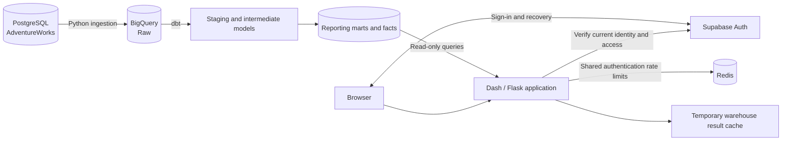

# AdventureWorks Analytics

An authenticated analytics application and data platform built with **Plotly Dash,
Flask, Supabase, Google BigQuery, and dbt**. Explore sales performance, wholesale
operations, growth, and customer trends through interactive reports backed by an
AdventureWorks warehouse.

**[Open the live application](https://adventureworks-analytics-snowy.vercel.app)** ·
[Account management](docs/account-management.md) ·
[Warehouse guide](adventureworks_analytics/docs/PROJECT_GUIDE.md)

## Features

- **Sales reporting:** revenue, profit, order metrics, product performance, and
  comparisons across reporting periods.
- **Wholesale analysis:** reseller performance, product mix, and fulfillment views.
- **Growth and customer insights:** seasonality, customer segments, and regional
  analysis.
- **Shared report filters:** calendar year, quarter, sales channel, category, and
  dependent product subcategory.
- **Warehouse exploration:** read-only previews of curated product, customer, and
  sales tables, with search, sorting, filtering, and pagination.
- **Account management:** verified-email access, Google/GitHub sign-in when enabled,
  password recovery, administrator roles, suspension, and protected owner controls.
- **Display preferences:** light/dark themes and browser-local interface settings.

### What uses real data?

| Area                                                             | Data source and scope                                                                         |
| ---------------------------------------------------------------- | --------------------------------------------------------------------------------------------- |
| Revenue, wholesale, growth, and customer reports                 | Read-only BigQuery queries against reporting marts and facts                                  |
| Tables                                                           | BigQuery previews of `dim_product`, `dim_customer`, and `fct_sales`; up to 500 displayed rows |
| User Management                                                  | Supabase account directory and server-authorized account actions                              |
| Dashboard activity and pipeline monitoring                       | Synthetic fixtures, not live operational telemetry                                            |
| Workspace freshness, saved views, quality, and glossary sections | Labeled sample content                                                                        |

Table search, sorting, filters, and pagination apply to the **loaded preview**, not
the entire warehouse. Preview queries use a 100 MiB billing ceiling and a
60-second result cache. Opening the app does not run ingestion or dbt jobs.

## Architecture



**Supabase** manages identities and server-controlled account roles. **Redis**
synchronizes authentication request limits across deployed app instances; it does
not store passwords or analytics records. **BigQuery** serves report data, while
Flask-Caching keeps temporary warehouse results separate from authentication state.

## Technology

| Layer                        | Tools                                                                    |
| ---------------------------- | ------------------------------------------------------------------------ |
| Application                  | Python 3.12, Plotly Dash, Flask, Dash Bootstrap Components, Dash AG Grid |
| Authentication               | Supabase Auth, Supabase JS, OAuth PKCE, server-side token verification   |
| Warehouse                    | Google BigQuery, pandas, PyArrow                                         |
| Transformation and ingestion | dbt, Python, SQLAlchemy, PostgreSQL                                      |
| Caching and rate limiting    | Flask-Caching, Redis, Flask-Limiter                                      |
| Build and runtime            | uv, Node.js 22+, npm, esbuild, Docker, Gunicorn                          |
| Quality checks               | Ruff, Black, mypy, Bandit, detect-secrets, pip-audit, Prettier           |

Python dependency versions are pinned in `pyproject.toml` and resolved in
`uv.lock`. Frontend dependencies use `package-lock.json`.

## Run locally

### 1. Install dependencies

Install Python 3.12, [uv](https://docs.astral.sh/uv/), and Node.js 22 or newer.
From the repository root:

```sh
uv sync --locked --python 3.12
npm ci
npm run build:auth
uv run --locked pre-commit install
```

### 2. Configure private settings

Copy the supplied template and fill in your own configuration:

```sh
cp .env.example .env
```

| Variable                               | Purpose                                                                            |
| -------------------------------------- | ---------------------------------------------------------------------------------- |
| `NEXT_PUBLIC_SUPABASE_URL`             | Supabase project URL                                                               |
| `NEXT_PUBLIC_SUPABASE_PUBLISHABLE_KEY` | Public browser key; the legacy anon-key variable is also supported                 |
| `AUTH_APP_ORIGIN`                      | Exact application origin; normally `http://127.0.0.1:8050` locally                 |
| `FLASK_SECRET_KEY`                     | Stable, randomly generated application secret                                      |
| `AUTH_OAUTH_PROVIDERS`                 | `google,github` when both providers are configured in Supabase                     |
| `SUPABASE_SERVICE_ROLE_KEY`            | Server-only credential for account administration and optional password lockout    |
| `RATE_LIMIT_ENVIRONMENT`               | Explicitly `development` for local in-memory limiting                              |
| `RATE_LIMIT_REDIS_URL`                 | Shared Redis connection required in production                                     |
| `GBQ_PROJECT_ID`                       | Google Cloud project used for warehouse queries                                    |
| `BQ_ANALYTICS_DATASET`                 | Reporting dataset; defaults to `gold_adventureworks`                               |
| `BQ_STAGING_DATASET`                   | Staging dataset used by wholesale fulfillment; defaults to `silver_adventureworks` |

Configure Google Application Default Credentials with access to the intended
warehouse. A private service-account file can be referenced through
`GOOGLE_APPLICATION_CREDENTIALS`; never commit that file.

Follow the [account-management guide](docs/account-management.md) to configure
Supabase migrations, email confirmation, providers, and the initial protected
owner. The older workspace-approval flow is retired. A blank OAuth provider setting
hides the corresponding sign-in buttons.

Keep `.env`, credentials, refresh tokens, and service-role keys outside version
control. `SUPABASE_DB_URL` is for explicit operator tools, **not** the web runtime.

### 3. Start the application

```sh
uv run --locked python my-dash-app/app.py
```

Open <http://127.0.0.1:8050> using the same origin configured above. Warehouse
reports require working Google credentials and the expected dbt models; the app
does not create or populate the warehouse during startup.

## Authentication and access

New users register with email and password, confirm their email, then sign in.
Confirmed, active accounts access the shared analytics application. Google and
GitHub sign-in require enabled providers and an existing matching verified-email
account under the email-first registration policy.

The server verifies Supabase identity on protected requests. Administrator and
owner permissions come from server-controlled account metadata, never browser
state. Administrators manage roles and suspension at `/admin/users`; only the
protected owner can permanently delete eligible suspended members after email
confirmation. Database guards protect the owner and enforce account invariants.

The app retains exact-Origin validation, cookie-bound CSRF, secure production
cookies, and shared Redis rate limiting. The additional five-attempt password
lockout is **disabled by default** and requires its separately coordinated rollout
before setting `AUTH_PASSWORD_LOCKOUT_ENABLED=true`.

See [account management](docs/account-management.md),
[CSRF protection](docs/csrf-protection.md), and
[authentication rate limits](docs/auth-rate-limits.md).

## Repository structure

```text
my-dash-app/                 Dash pages, Flask authentication, report loaders, assets
auth_frontend/              Supabase session, signup, recovery, and CSRF sources
adventureworks_analytics/    dbt staging, intermediate models, marts, and SQL tests
supabase/                   Versioned migrations, Auth templates, isolated SQL tests
tests/                      Offline Python regression tests
scripts/                    Build, verification, and explicit operator tools
docs/                       Setup, security, performance, and operating guides
design-system/              Shared visual specifications and page guidelines
db_connector.py             PostgreSQL and BigQuery engine helpers
elt_pipeline.py             Guarded PostgreSQL-to-BigQuery ingestion
Dockerfile                  Auth build and non-root Python/Gunicorn runtime
```

## Warehouse and dbt

The ingestion pipeline loads AdventureWorks source tables from PostgreSQL into
BigQuery. dbt normalizes source data and builds dimensions, sales facts, and
reporting marts. See the [warehouse operating guide](adventureworks_analytics/docs/PROJECT_GUIDE.md)
and [model lineage](adventureworks_analytics/docs/LINEAGE.md) for model details and
metric semantics.

Run the ingestion preflight without source reads or destination writes:

```sh
uv run --locked python elt_pipeline.py --dry-run
```

**Ingestion uses `WRITE_TRUNCATE` and replaces destination table data.** Production
execution requires explicit operator authorization and destination confirmation.
Follow the [ELT safety guide](docs/elt-safety.md); do not use real ingestion as a test.

Generated dbt artifacts live under `adventureworks_analytics/target/` and are not
currently connected to live monitoring in the application.

## Verification

Run the offline application tests and frontend checks:

```sh
uv run --locked python scripts/pre_commit_checks.py python-tests
npm run test:auth
```

The Python wrapper selects isolated testing rate limits and clears production
Redis settings. Application tests mock external services; passing them does not
prove live warehouse access, email delivery, or deployed authentication flows.

Run the full repository hooks, including dependency advisory checks:

```sh
uv run --locked pre-commit run --all-files
```

Some checks require network access. See the [pre-commit guide](docs/pre-commit.md)
and [security check boundaries](docs/security-checks.md) for details.

## Deployment

The application has been deployed to
[Vercel](https://adventureworks-analytics-snowy.vercel.app) using its container
runtime. As of **20 October 2026**, the deployment configuration and startup helper
are preserved in commit `6e1ed78` on `codex/account-management-warehouse-tables`,
separately from the authentication changes merged through PR #21. They are not yet
part of `main`.

The checked-in `Dockerfile` builds authentication assets with Node.js, installs
locked Python dependencies, and runs Gunicorn as a non-root user on port 8050.
Supply runtime credentials separately from the image. Production requires shared
Redis and an exact HTTPS application origin.

Supabase's Site URL and redirect allowlist must match the deployed application.
Allow `/auth/callback` with the app's query parameters and
`/auth/recovery?step=update`. Provider callbacks in Google/GitHub point to Supabase's
`/auth/v1/callback`, which is distinct from the application's callback URL.

Deployment does not automatically apply database migrations or change provider
configuration. Follow the coordinated rollout and rollback notes in
[account management](docs/account-management.md).

## Further documentation

- [Current account model and rollout](docs/account-management.md)
- [Legacy account history preservation](docs/legacy-account-history.md)
- [Warehouse project guide](adventureworks_analytics/docs/PROJECT_GUIDE.md)
- [dbt model lineage](adventureworks_analytics/docs/LINEAGE.md)
- [Warehouse cache behavior](docs/cache-coverage.md)
- [ELT production safety](docs/elt-safety.md)
- [Security assessment and implementation history](SECURITY_AUDIT.md)
- [Pull request workflow](docs/pull-request-workflow.md)
