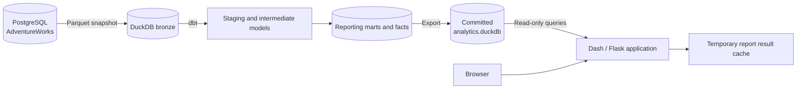

# AdventureWorks Analytics

A public analytics application and data platform built with **Plotly Dash, Flask,
DuckDB, and dbt**. Explore sales performance, wholesale operations, growth, and
customer trends through interactive reports backed by an AdventureWorks warehouse
that ships as one read-only analytics file — no sign-in required.

**[Open the live application](https://adventureworks-analytics-snowy.vercel.app)** ·
[Warehouse guide](adventureworks_analytics/docs/PROJECT_GUIDE.md)

## Features

- **Sales reporting:** revenue, profit, order metrics, product performance, and
  comparisons across reporting periods.
- **Wholesale analysis:** reseller performance, product mix, and fulfillment views.
- **Growth and customer insights:** seasonality, customer segments, and regional
  analysis.
- **Shared report filters:** calendar year, quarter, sales channel, category, and
  dependent product subcategory.
- **Warehouse exploration:** read-only previews of curated product, customer, and
  sales tables, with search, sorting, filtering, and pagination.
- **Display preferences:** light/dark themes and browser-local interface settings.

### What uses real data?

| Area                                                             | Data source and scope                                                                                            |
| ---------------------------------------------------------------- | ---------------------------------------------------------------------------------------------------------------- |
| Revenue, wholesale, growth, and customer reports                 | Read-only DuckDB queries against the shipped `analytics.duckdb` reporting marts and facts                        |
| Tables                                                           | Read-only previews of `dim_product`, `dim_customer`, and `fct_sales` from the artifact; up to 500 displayed rows |
| Dashboard activity and pipeline monitoring                       | Synthetic fixtures, not live operational telemetry                                                               |
| Workspace freshness, saved views, quality, and glossary sections | Labeled sample content                                                                                           |

Table search, sorting, filters, and pagination apply to the **loaded preview**, not
the entire warehouse. Preview queries are bounded and reuse a 60-second result
cache. Opening the app does not run ingestion or dbt jobs.

## Architecture



The application is public: no authentication, sign-in, or rate-limiting services
are involved. **DuckDB** serves report data from the committed artifact, while
Flask-Caching keeps temporary report results in each server instance's `/tmp`.

## Technology

| Layer                        | Tools                                                                    |
| ---------------------------- | ------------------------------------------------------------------------ |
| Application                  | Python 3.12, Plotly Dash, Flask, Dash Bootstrap Components, Dash AG Grid |
| Warehouse                    | DuckDB artifact, pandas, PyArrow                                         |
| Transformation and ingestion | dbt, Python, SQLAlchemy, PostgreSQL                                      |
| Caching                      | Flask-Caching (per-instance FileSystemCache)                             |
| Build and runtime            | uv, Docker, Gunicorn                                                     |
| Quality checks               | Ruff, Black, mypy, Bandit, detect-secrets, pip-audit, Prettier           |

Python dependency versions are pinned in `pyproject.toml` and resolved in
`uv.lock`. Frontend dependencies use `package-lock.json`.

## Run locally

### 1. Install dependencies

Install Python 3.12 and [uv](https://docs.astral.sh/uv/). From the repository root:

```sh
uv sync --locked --python 3.12
uv run --locked pre-commit install
```

### 2. Optional configuration

The app runs with no credentials. `.env.example` documents optional overrides such
as `GOLD_DATABASE_PATH` for the artifact location and the local cache budget.
Keep any private `.env` values outside version control.

Reports read the committed `my-dash-app/data/analytics.duckdb` artifact, so local
startup needs no Google Cloud credentials or warehouse connection. Rebuild the
artifact only when dbt models or source data change; see [warehouse and dbt](#warehouse-and-dbt).

### 3. Start the application

```sh
uv run --locked python my-dash-app/app.py
```

Open <http://127.0.0.1:8050>. Warehouse reports require the shipped DuckDB
artifact; the app does not create or populate it during startup.

## Access

The application is public by owner decision (2026-11-12): `/` redirects to
`/dashboard` and every page is reachable without signing in. Authentication,
workspace governance, and rate limiting were removed from the runtime; the
historical design lives in git history and in the audit documents.

## Repository structure

```text
my-dash-app/                 Dash pages, report loaders, and assets
adventureworks_analytics/    dbt staging, intermediate models, marts, and SQL tests
supabase/                   Historical governance migrations and templates (unused)
tests/                      Offline Python regression tests
scripts/                    Verification and explicit operator tools
docs/                       Setup, security, performance, and operating guides
design-system/              Shared visual specifications and page guidelines
db_connector.py             PostgreSQL and legacy BigQuery engine helpers
elt_pipeline.py             Guarded PostgreSQL-to-BigQuery ingestion (operator tooling)
Dockerfile                  Single-stage Python build and non-root Gunicorn runtime
```

## Warehouse and dbt

The app reads one committed DuckDB file, `my-dash-app/data/analytics.duckdb`. It
contains the `gold_adventureworks` reporting tables and the staging fact used by
wholesale fulfillment. The file is produced offline: the Parquet snapshot under
`data/raw/adventureworks_dw` loads into a build database, dbt builds the models, and
`scripts/export_gold_duckdb.py` writes the slim runtime artifact. Schema names keep
the former BigQuery dataset names the loader SQL expects.

Rebuild and verify the artifact from the repository root:

```sh
uv run --locked python -B scripts/load_bronze_duckdb.py
# run dbt build against adventureworks_analytics/build/analytics.duckdb
uv run --locked python scripts/export_gold_duckdb.py
uv run --locked python scripts/verify_shipped_gold.py
```

See the [warehouse operating guide](adventureworks_analytics/docs/PROJECT_GUIDE.md)
and [model lineage](adventureworks_analytics/docs/LINEAGE.md) for model details and
metric semantics.

The repository also retains the legacy PostgreSQL-to-BigQuery ingestion path for
explicit operator use. Run its preflight without source reads or destination writes:

```sh
uv run --locked python elt_pipeline.py --dry-run
```

**Legacy ingestion uses `WRITE_TRUNCATE` and replaces destination table data.**
Production execution requires explicit operator authorization and destination
confirmation. Follow the [ELT safety guide](docs/elt-safety.md); do not use real
ingestion as a test. The deployed app does not call this path.

Generated dbt artifacts live under `adventureworks_analytics/target/` and are not
currently connected to live monitoring in the application.

## Verification

Run the offline application tests:

```sh
uv run --locked python scripts/pre_commit_checks.py python-tests
```

Application tests mock external services; passing them does not prove live
warehouse or deployment behavior.

Run the full repository hooks, including dependency advisory checks:

```sh
uv run --locked pre-commit run --all-files
```

Some checks require network access. See the [pre-commit guide](docs/pre-commit.md)
and [security check boundaries](docs/security-checks.md) for details.

## Deployment

The application runs on [Vercel](https://adventureworks-analytics-snowy.vercel.app)
using its container runtime. `vercel.json` forces the container framework preset
and selects the repository `Dockerfile`, which installs locked Python
dependencies, ships `my-dash-app/data/analytics.duckdb`, and starts Gunicorn as a
non-root user on the `PORT` environment variable (8050 by default).

The container startup helper validates the DuckDB artifact before serving requests.
Deployment needs no credentials or project environment variables. Deployments run
through GitHub Actions: previews on pull requests and pushes to `main`, production
only via a manual workflow run with `target=production`. See the
[Vercel deployment guide](docs/vercel-deployment.md).

An earlier deployment used BigQuery and runtime Google credentials; the hosted
application is migrated to the artifact runtime once the preview checks in the
deployment guide pass on a promoted build.

## Further documentation

- [Vercel deployment](docs/vercel-deployment.md)
- [Warehouse project guide](adventureworks_analytics/docs/PROJECT_GUIDE.md)
- [dbt model lineage](adventureworks_analytics/docs/LINEAGE.md)
- [Warehouse cache behavior](docs/cache-coverage.md)
- [ELT production safety](docs/elt-safety.md)
- [Security assessment and implementation history](SECURITY_AUDIT.md)
- [Pull request workflow](docs/pull-request-workflow.md)
